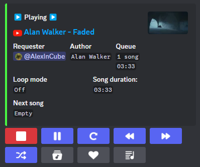

    

<h1 align="center">AICTest</h1>

Cool audiobot for Discord created by <a href="https://vk.com/alexincube"><b>@AlexInCube</b></a>

## 🖥️ Setup
- Go to [Docs Setup Section](https://alexincube.github.io/AlCoTest/setup)

## 🌟 Features

- Audioplayer based on [Distube](https://github.com/skick1234/DisTube) with buttons
- Playlists for songs
- Lyrics for songs
- Downloading of songs via /download command
- Support YouTube, Spotify, Soundcloud, Apple Music, any HTTP-stream and Discord Attachments (/playfile support MP3/WAV/OGG)
- Support Slash and Text commands system (with customizable prefix per server using /setprefix)
- Localization (English and Russian are currently supported)
- Command /alcotest which shows your alcohol count in blood
- Go to [Docs](https://alexincube.github.io/AlCoTest/) to get more information about features, commands, and others.

## 🐛 Bugs or problems

If you have issues, try to update your `docker-compose.yml`, `updateAndRunInDocker.sh` files.
And run `sh updateAndRunInDocker.sh`. 
If bugs are persisted on the latest version of bot,
please create [issue](https://github.com/AlexInCube/AlCoTest/issues/new/choose).
